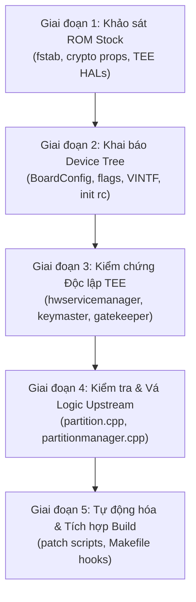

# Quy trình & Lưu ý Chuẩn khi Triển khai Giải mã /data cho Custom Recovery

Tài liệu này chuẩn hóa quy trình 5 giai đoạn và các cạm bẫy kỹ thuật kinh điển khi mang tính năng giải mã phân vùng `/data` (File-Based Encryption) lên các bản Custom Recovery (TWRP / OrangeFox / PBRP).

---

## 1. Kiến trúc Cốt lõi & Cơ chế Cần Nắm Vững

### A. Mô hình FBE (File-Based Encryption)
* **Khóa DE (Device Encrypted)**: Được tạo tự động khi format data. Nạp vào kernel để đọc các thư mục hệ thống thiết yếu trước khi người dùng mở khóa màn hình (`/data/system`, `/data/misc`, và đặc biệt là `/data/misc/vold/user_keys/ce/0/current`).
* **Khóa CE (Credential Encrypted)**: Mã hóa dữ liệu người dùng (`/data/media/0` -> `/sdcard`, `/data/system_ce/0`). Khóa này được mã hóa bảo vệ bởi Master Key của TEE (Keymaster/Gatekeeper) kết hợp mật khẩu/mã PIN của user.
* **Nguyên lý phụ thuộc**: Không thể giải mã CE nếu chưa giải mã thành công DE. Nếu DE bị lỗi, file blob chứa khóa CE trong `/data/misc/vold/...` vẫn là ciphertext, dẫn tới lỗi `ENOENT` hoặc `unlock_user_key returned fail`.

### B. Cơ chế Kernel Superblock Keyring (Linux Kernel 4.19+)
* Trên Linux 4.14 trở về trước, key fscrypt được quản lý theo session keyring của tiến trình.
* Trên Linux 4.19+ (`ro.crypto.uses_fs_ioc_add_encryption_key=true`): Khóa được gắn trực tiếp vào **Superblock của filesystem đang mount** (`sb->s_master_keys`).
* **HỆ QUẢ BẮT BUỘC GHI NHỚ**: **Bất kỳ lệnh `umount()` nào lên `/data` đều sẽ lập tức hủy sạch (wipe) toàn bộ encryption keys trong kernel**. Nếu recovery unmount `/data` sau khi nạp DE key, mọi khóa đã nạp sẽ biến mất!

---

## 2. Quy trình 5 Giai đoạn Triển khai (5-Phase Bringup Process)



### Giai đoạn 1: Khảo sát ROM Stock (Stock Inspection)
Trước khi viết mã, trích xuất thông tin từ ROM gốc (hoặc qua `adb shell` khi chạy ROM stock):
1. **Kiểm tra loại mã hóa**:
   ```bash
   getprop ro.crypto.type          # file (FBE) hoặc block (FDE)
   getprop ro.crypto.state         # encrypted
   ```
2. **Kiểm tra thuật toán & phiên bản FBE trong vendor fstab**:
   Xem dòng `/data` trong `vendor/etc/fstab.*`:
   `fileencryption=aes-256-xts:aes-256-cts:v1` (FBE v1) hoặc `v2` (Android 11+).
3. **Xác định TEE & Keymaster HAL Provider**:
   ```bash
   getprop ro.hardware.gatekeeper   # vd: beanpod, trustonic, mtk, qcom
   ps -A | grep -E 'keymaster|gatekeeper|tee'
   ```
4. **Xác định phân vùng phụ thuộc TEE**:
   Kiểm tra fstab các phân vùng nạp trước khi khởi động TEE: `metadata`, `persist`, `protect_f`, `protect_s`, `nvdata`, `nvcfg`.

---

### Giai đoạn 2: Cấu hình Device Tree

1. **`BoardConfig.mk`**:
   ```makefile
   TW_INCLUDE_CRYPTO := true
   TW_INCLUDE_FBE := true
   TW_INCLUDE_FBE_METADATA_DECRYPT := true  # Nếu có metadata encryption
   ```
2. **Đồng bộ Mount Point trong `recovery.fstab` và `twrp.flags`**:
   * Nếu `recovery.fstab` mount `/mnt/vendor/persist` thì `twrp.flags` PHẢI khai báo tương thích. Tránh trường hợp `recovery.fstab` dùng đường dẫn vendor còn `twrp.flags` dùng đường dẫn gốc gây cảnh báo `Unable to mount` trùng block device.
3. **VINTF Manifests (`recovery/root/vendor/etc/vintf/manifest/`)**:
   * Khai báo đầy đủ manifest cho `android.hardware.keymaster@4.0` (hoặc 3.0/4.1) và `android.hardware.gatekeeper@1.0`.
4. **Init RC Scripts (`init.recovery.<platform>.rc`)**:
   * Khởi động `hwservicemanager` trước.
   * Khởi động TEE daemon nền (ví dụ `teei_daemon`).
   * Khởi động Keymaster HAL và Gatekeeper HAL dạng service HIDL.
   * Đảm bảo set các SELinux context thích hợp cho socket/pipe của TEE.

---

### Giai đoạn 3: Kiểm chứng Độc lập TEE & Hardware Decryption

> [!TIP]
> Không nên dựa hoàn toàn vào GUI Recovery khi mới debug. Hãy tách biệt lỗi giữa phần cứng TEE và lỗi logic của recovery.

1. **Kiểm tra trạng thái Service qua ADB**:
   ```bash
   adb shell "getprop | grep -E 'init.svc.keymaster|init.svc.gatekeeper|teei'"
   ```
   Tất cả service HAL phải ở trạng thái `running`. Nếu `restarting` hoặc không chạy, kiểm tra thiếu thư viện động `.so` hoặc thiếu tệp TA (`/vendor/thh/ta/...`).
2. **Kỹ thuật Biên dịch Binary Test ARM64 Độc lập**:
   Biên dịch một file C++ nhỏ liên kết với `/system/lib64/libtwrpfscrypt.so` có sẵn trên máy:
   * Bước 1: Gọi `Decrypt_DE()` -> Kiểm tra xem `/data/misc/vold/user_keys/ce/0/current` đã đọc được plaintext chưa.
   * Bước 2: Gọi `Decrypt_User(0, "!")` -> Kiểm tra xem TEE có unwrap được CE key và mở khóa `/data/media/0` không.
   * Nếu tool test chạy thành công nhưng recovery vẫn báo lỗi -> 100% là do bug logic trong mã nguồn recovery!

---

### Giai đoạn 4: Các Lỗi Logic Kinh Điển trong Upstream TWRP/OrangeFox

Dưới đây là 5 bug phổ biến nhất trong `bootable/recovery` khi chạy FBE trên Kernel 4.19+:

#### Bug 1: Đảo ngược logic kiểm tra `Decrypt_FBE_DE()` trong `partition.cpp`
* **Vấn đề**:
  ```cpp
  // Code lỗi upstream:
  if (!Decrypt_FBE_DE() && strcmp(crypto_state, "error") != 0) { ... }
  else {
      DataManager::SetValue(TW_IS_ENCRYPTED, 0);
      if (datamedia) Setup_Data_Media();
  }
  ```
  Khi `Decrypt_FBE_DE()` thành công (trả về `true`), điều kiện `!Decrypt_FBE_DE()` là `false`, code nhảy sang nhánh `else` -> đánh dấu máy KHÔNG bị mã hóa (`TW_IS_ENCRYPTED = 0`) và gọi `Setup_Data_Media()`.
* **Khắc phục**: Tách riêng kiểm tra:
  ```cpp
  if (!Decrypt_FBE_DE()) {
      if (strcmp(crypto_state, "error") != 0) { ... }
      else {
          DataManager::SetValue(TW_IS_ENCRYPTED, 0);
          if (datamedia) Setup_Data_Media();
      }
  }
  ```

#### Bug 2: Unmount `/data` trong `Setup_Data_Media()` làm mất Superblock Keyring
* **Vấn đề**:
  Trong `TWPartition::Setup_Data_Media()`, sau khi kiểm tra đường dẫn `/data/media/0`, code gọi `UnMount(true);`. Trên Kernel 4.19, lệnh unmount này **xóa sạch toàn bộ key vừa nạp**.
* **Khắc phục**:
  Chặn unmount đối với thiết bị FBE:
  ```cpp
  if (!Is_FBE)
      UnMount(true);
  ```

#### Bug 3: Thiếu tự động nạp lại DE Key trước khi Decrypt User
* **Vấn đề**:
  Khi người dùng nhập mật khẩu hoặc recovery tự giải mã User 0, hàm `Decrypt_Device()` mount lại `/data`. Nếu DE key chưa được nạp vào filesystem superblock mới mount, recovery không thể đọc được thư mục chứa CE key.
* **Khắc phục**:
  Thêm kiểm tra và tự động reload trong `partitionmanager.cpp`:
  ```cpp
  if (!TWFunc::Path_Exists("/data/misc/vold/user_keys/ce/0/current")) {
      LOGINFO("DE keys missing after mounting /data, reloading via Decrypt_DE...\n");
      Decrypt_DE();
  }
  ```

#### Bug 4: Bỏ quên `Setup_Data_Media()` và MTP trong `Post_Decrypt()`
* **Vấn đề**:
  Khi khởi động với FBE, `/data` bị mã hóa nên `Setup_Data_Media()` bị bỏ qua -> `dat->Has_Data_Media` vẫn là `false`. Sau khi giải mã thành công trong `Post_Decrypt()`, nếu không khởi tạo `Setup_Data_Media()`, biến `tw_has_internal` sẽ bị rỗng -> Recovery báo `Unable to mount storage`.
* **Khắc phục**:
  Trong `TWPartitionManager::Post_Decrypt()`:
  ```cpp
  if (dat->Mount(false)) {
      if (!dat->Has_Data_Media)
          dat->Setup_Data_Media();
      if (TWFunc::Path_Exists("/data/media/0")) {
          dat->Storage_Path = "/data/media/0";
          dat->Symlink_Path = dat->Storage_Path;
          Setup_Settings_Storage_Partition(dat);
      }
  }
  Update_System_Details();
  Output_Partition(dat);
  if (!dat->Bind_Mount(false))
      LOGERR("Unable to bind mount /sdcard to %s\n", dat->Storage_Path.c_str());
  if (dat->MTP_Storage_ID == 0)
      dat->MTP_Storage_ID = 0x00010002;
  Add_MTP_Storage(dat->MTP_Storage_ID);
  ```

#### Bug 5: Chặn bind-mount sai trên thiết bị eMMC
* **Vấn đề**:
  Một số bản nhánh OrangeFox có đoạn kiểm tra:
  `if (!android::base::StartsWith(dat->Actual_Block_Device, "/dev/block/mmcblk"))`
  Điều này khiến mọi máy dùng bộ nhớ eMMC (`/dev/block/mmcblk0p*`) bị bỏ qua lệnh bind-mount `/data/media/0` vào `/sdcard`.
* **Khắc phục**: Gỡ bỏ điều kiện `StartsWith mmcblk` để luôn luôn thực hiện bind-mount khi có emulated storage.

---

### Giai đoạn 5: Tự động hóa Bản vá khi Biên dịch

1. **Nguyên tắc đóng gói**:
   Mã nguồn recovery trên CI/Colab thường được clone tự động từ remote gitlab/github. Toàn bộ bản vá phải nằm trong Device Tree và tự động áp dụng khi gọi build.
2. **Kỹ thuật viết script Python patcher (`patch_fbe.py`)**:
   * Sử dụng string replacement chính xác theo khối code.
   * Đảm bảo tính **Idempotent**: chạy nhiều lần không gây lỗi và không lặp code.
   * Tự động dò tìm thư mục `bootable/recovery` qua các cấp tương đối (`../../../../bootable/recovery`).
3. **Cạm bẫy Makefile `$(shell ...)` trong `Android.mk`**:
   * **LỖI**: Gọi `$(shell python3 script.py)` trực tiếp trong Makefile mà script có in ra text chứa dấu `:` (ví dụ `Target directory: ...`) sẽ khiến trình biên dịch (`ckati` / GNU Make) báo lỗi nghiêm trọng:
     `error: multiple target patterns.`
   * **CÁCH VIẾT CHUẨN**: Luôn gán vào biến giả (`dummy variable`) và chuyển hướng output sang `stderr`:
     ```makefile
     _dummy := $(shell if [ -f $(LOCAL_PATH)/patches/patch_fbe.py ]; then python3 $(LOCAL_PATH)/patches/patch_fbe.py >&2; fi)
     ```
